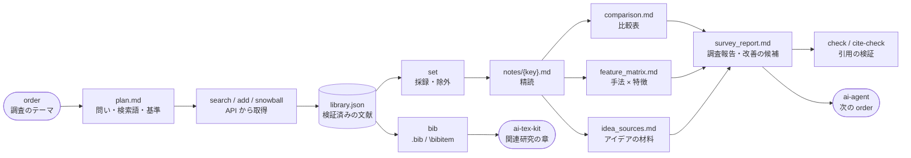

# ai-survey-kit
`ai-survey-kit` は，AIエディタ（Claude Code等）に**捏造の無い文献調査**と，調査に基づく**研究のアイデア出し**を行わせるための規約・テンプレート・CLIである．
文献の書誌情報は OpenAlex，arXiv，Crossref の API から取得して文献ライブラリ（`survey/library.json`）に登録し，調査報告や論文で引用してよいのはこのライブラリに登録・採録された文献のみとする．
これを `surveykit.py check` と `surveykit.py cite-check` で機械的に検証する．



---

# 最重要の原則：文献を捏造しない
AIエディタは，学習した知識から文献の書誌情報（著者，年，タイトル，掲載先，DOI）や内容を書いてはならない．

- 書誌情報は必ず `surveykit.py search`／`add`／`snowball` で API から取得する．`library.json` を手作業で編集しない．
- 引用は引用キーで行う（Markdown は `[@key]`，TeX は `\cite{key}`）．引用してよいのは `status` が `included` の文献のみである．
- 要旨のみを読んだ文献について，要旨に書かれていない手法の詳細や数値を書かない．
- API に接続できない場合に，記憶に基づいて文献を補ってはならない．

詳細は `survey.md` の「0. 最重要の原則」を参照する．

---

# 特徴
| 機能 | 内容 |
| :--- | :--- |
| 文献の取得 | キーワード検索（関連度順・被引用数順・新着順），DOI・arXiv ID・OpenAlex ID・タイトルによる登録 |
| スノーボーリング | 起点の文献の参考文献（過去の研究）と被引用文献（後続の研究）を候補に加える |
| 重複の統合 | DOI，arXiv ID，OpenAlex ID，タイトルで同じ文献を判定し，1件に統合する |
| スクリーニングの記録 | 文献ごとの採録・除外と除外の理由，検索の記録（PRISMA の流れ図に相当する集計） |
| 精読ノート | 要旨を埋め込んだノートの雛形．読んだ範囲（要旨のみ／全文）を記録する |
| 比較表 | ノートのフロントマターから採録文献の比較表を生成する |
| 特徴行列 | 手法 × 特徴の表（✓/△/✗）で既存手法と本研究の立ち位置を示し，空白（満たす手法が無い特徴，両立する手法が無い特徴の組）を自動で抽出する．論文用の LaTeX の表も出力できる |
| アイデアの材料 | 特徴行列の空白，ノートの前提・限界・疑問，ai-dev-kit の report の予想と異なった結果，気づきのメモを観点ごとに1つのファイルに集める |
| 改善の候補 | 10種類の観点（空白，前提を壊す，極端化・単純化，他分野からの持ち込み，評価を疑う，実験の違和感 等）から，根拠・新規性・最小の検証実験・捨てる条件を持つ候補を書かせ，検証する |
| 参考文献 | BibTeX，または ai-tex-kit の `thebibliography` 用の `\bibitem` を，本文の引用順に出力する |
| 引用の検証 | ライブラリに無い文献，API で検証されていない文献，採録していない文献の引用，未定義・未使用の参考文献を検出する |

---

# ファイル構成
AIエディタは，文献調査・関連研究の執筆・研究のアイデア出しを依頼された場合，本ファイルに加えて `survey.md` と `ideation.md` を必ず読み込む．

| ファイル | 内容 | 読むタイミング |
| :--- | :--- | :--- |
| `README.md` | 本ファイル．概要と使い方 | 最初 |
| `survey.md` | **文献調査の手順と規約（必読）** | 調査の全工程 |
| `ideation.md` | **研究のアイデア（改善の候補）を見いだす観点と書き方（必読）** | 統合・執筆時，アイデア出しの依頼時 |
| `templates/plan.md` | 調査計画のテンプレート | `init` が使用 |
| `templates/note.md` | 文献ごとのノートのテンプレート | `note` が使用 |
| `templates/survey_report.md` | 調査報告のテンプレート | `init` が使用 |
| `templates/ours.md` | 特徴行列の本研究の行のテンプレート | `ours` が使用 |
| `scripts/surveykit.py` | CLI（標準ライブラリのみで動作） | 全工程 |
| `examples/order_example.md` | 調査を依頼する order の例 | 依頼時 |
| `tests/test_surveykit.py` | `surveykit.py` のテスト | kitの開発時 |

---

# 導入
ai-dev-kit の `init_project.sh` を実行すると，`.ai/ai-survey-kit` にサブモジュールとして自動で追加される．
`@.ai/ai-dev-kit/root_prompt.md` の「読み込むドキュメント」の表から本kitの規約が参照されるため，orderに本ファイルの参照を書く必要は無い．

```bash
bash <(curl -fsSL https://raw.githubusercontent.com/yryo1005/ai-dev-kit/master/init_project.sh) --tokens
```

既存のプロジェクトに追加する場合は，以下を実行する．

```bash
git submodule add https://github.com/yryo1005/ai-survey-kit.git .ai/ai-survey-kit
```

API への接続を確認する．

```bash
python .ai/ai-survey-kit/scripts/surveykit.py doctor
```

OpenAlex・Crossref の polite pool（安定した応答の得られる接続）を利用する場合は，連絡先のメールアドレスを環境変数に設定する（任意）．
AIエディタはユーザーのメールアドレスを自ら設定しない．

```bash
export SURVEYKIT_MAILTO="you@example.com"
```

---

# 使い方
order に調査のテーマを書く（`examples/order_example.md` を参照）．記載の無い項目は `survey.md` の Phase 0 の既定値（採録15〜30件，全文を読むのは5〜10件 等）が用いられる．

```text
Deep Variational Information Bottleneck に関する文献調査を行ってください．
* 目的: 論文の関連研究の章を書くため
* 起点: arXiv:1612.00410
```

AIエディタは `survey.md` の手順（Phase 0〜6）に従って以下を作成し，`check`・`cite-check` のエラーを0件にしてから報告する．

| 成果物 | 内容 |
| :--- | :--- |
| `survey/plan.md` | 調査の目的，調査で答える問い（RQ），検索語，採録・除外の基準 |
| `survey/library.json` | API から取得した文献ライブラリ（`surveykit.py` のみが編集する） |
| `survey/notes/{key}.md` | 採録文献ごとのノート |
| `survey/comparison.md`，`survey/feature_matrix.md` | 比較表と特徴行列 |
| `survey/survey_report.md` | 調査報告（分類，未解決の課題，改善の候補，次に検討すべき事項） |
| `paper/references.tex` 等 | 参考文献リスト（order で論文の執筆を指示された場合のみ） |

`survey/pdfs/`（全文のPDF）は `init` が作成する `survey/.gitignore` により Git の管理対象外となる．

---

# `surveykit.py` のコマンド
プロジェクトルートで実行する．

```bash
K=.ai/ai-survey-kit/scripts/surveykit.py

python $K init --theme "Information Bottleneck による表現学習"     # survey/ を作成
python $K search "variational information bottleneck" --from-year 2016   # 検索して候補に登録
python $K search "information bottleneck" --sort cited                 # 被引用数の多い順
python $K search "information bottleneck" --source arxiv --sort date   # arXiv の新着順
python $K add --arxiv 1612.00410                                       # 識別子から登録（--doi，--openalex，--title も可）
python $K snowball alemi2016deep --direction both                      # 参考文献・被引用文献をたどる
python $K list --status candidate                                      # 一覧
python $K show alemi2016deep                                           # 詳細と要旨
python $K set alemi2016deep --status included                          # 採録
python $K set foo2020bar --status excluded --reason "画像以外の領域"     # 除外（理由は必須）
python $K note alemi2016deep                                           # ノートを作成
python $K table                                                        # 比較表を生成
python $K feature add closed_form --name "閉形式" --definition "目的関数を閉形式で計算できる"   # 特徴行列の列を定義
python $K ours                                                         # 本研究の行（survey/ours.md）を作成
python $K matrix                                                       # 特徴行列（--transpose で縦横を入れ替え）
python $K matrix --format tex --out paper/sections/feature_matrix.tex  # 論文用の表
python $K ideas                                                        # アイデアの材料を survey/idea_sources.md に集める
python $K memo "β=1e-4 で精度が逆転した" --source report_012 --lens 実験の違和感   # 気づきを記録
python $K bib --format bibtex --out survey/references.bib              # BibTeX
python $K bib --format bibitem --cited-in paper/sections --out paper/references.tex   # 本文の引用順の \bibitem
python $K cite-check paper/ survey/survey_report.md                    # 引用の検証
python $K check                                                        # 調査全体の検証と集計
python $K doctor                                                       # API への接続の確認
```

主なオプションは `python $K {コマンド} -h` で確認できる．

---

# 他のkitとの関係
| kit | 関係 |
| :--- | :--- |
| ai-dev-kit | order・report の運用と文章の表記（`documentation.md`）の規約に従う．`ideas` は `.reports/` の予想と異なった結果をアイデアの材料として集める |
| ai-tex-kit | 関連研究の章を書く際に，`bib --format bibitem` の出力をテンプレートの `thebibliography` に用いる．論文中の引用は `cite-check paper/` で検証する |
| ai-agent | `survey_report.md` の「未解決の課題」「改善の候補」「次に検討すべき事項」を research エージェントが次の order の手がかりにする |
| ai-learn-kit | 教材の発展ステージの題材や，解説で紹介する原論文を選ぶ際に，調査結果を参照できる |

---

# kitの開発
```bash
python -m pytest -q tests
```
